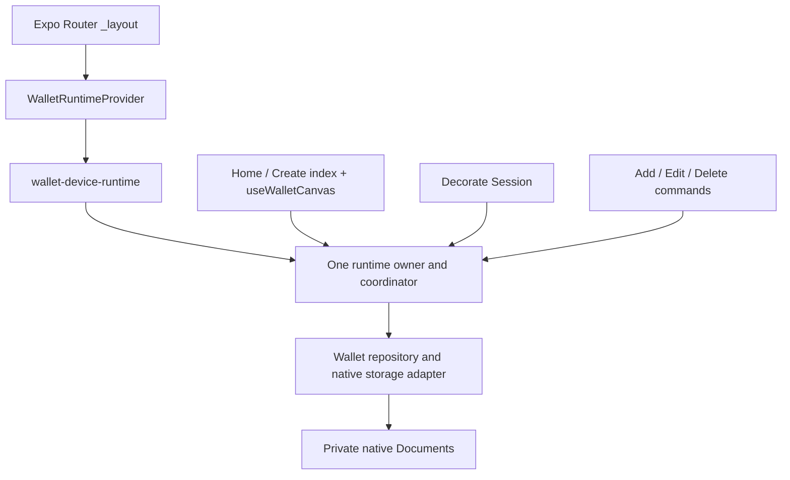

# bemem architecture and data contract

Current working-tree architecture for [Samsung Accepted Baseline2026-11-14](RELEASE-BASELINE.md). This document introduces no new runtime layer or schema.

## Boundaries

| Responsibility | Actual source |
| --- | --- |
| Fonts/routing/provider | `src/app/_layout.tsx`, `src/components/bemem/WalletRuntimeProvider.tsx` |
| Main Home/Create orchestration | `src/app/index.tsx`, `src/hooks/use-wallet-canvas.ts` |
| One runtime owner | `src/lib/wallet-device-runtime.ts`, `wallet-cutover-runtime.ts`, `wallet-runtime-owner.ts`, `wallet-coordinator.ts` |
| Snapshot IO | `src/lib/wallet-repository.ts`, `wallet-storage.ts`, `wallet-storage-adapters.ts`; legacy `canvas-storage.ts` |
| Create commands | `src/lib/wallet-feature-commands.ts`, `card-form-adapter.ts`, `membership-card-edit.ts` |
| Forms | `src/components/bemem/AddCardEditor.tsx`, `EditMembershipCardEditor.tsx`, shared `AddCardForm.tsx`/`AddCardSheet.tsx` |
| Canvas/pages | `WalletCanvas.tsx`, `src/lib/canvas-layout.ts`, `canvas-pages.ts`, `card-size-presets.ts`, `search-reflow.ts` |
| Decorate | `DecorateMode.tsx`, `src/lib/decorate-session.ts`, decoration catalog/pagination and bundled image registry |
| Folders | `src/types/group-folder.ts`, `src/lib/group-folder.ts`, `group-folder-visual.ts`, `GroupFolderCard.tsx`, `GroupFolderSheet.tsx` |
| Detail/codes/full view | `MembershipCardDetail.tsx`, `CardCodeView.tsx`, `FullScreenCardView.tsx`; `src/lib/card-code.ts`, `code128-display.ts` |
| Artwork | `src/lib/card-artwork-store.ts`, `card-artwork.ts`, `artwork-adjustment.ts`, `default-card-artwork*.ts`, `src/constants/default-card-artwork.ts`, `CardArtworkImage.tsx` |
| Share | `ShareCardSheet.tsx`, `CardShareSurface.tsx`, `src/lib/card-share-plan.ts`, `card-share-session.ts`, `card-share-native.ts` |
| History/receipts | `CardHistorySheet.tsx`, `ReceiptAttachments.tsx`, `ReceiptViewer.tsx`, `src/lib/card-history*.ts`, `receipt-picker.ts` |

Component filenames without a prefix are under `src/components/bemem/`; grouped lib filenames share the first listed directory. These are current paths, not proposed modules. Some source comments still describe early Phase2 milestones; follow actual call sites and this baseline rather than treating those historical comments as feature gates.

## Persisted model

`src/types/wallet-document.ts`: `{schemaVersion:2,dataset:'bemem-wallet',revision,savedAt,cards,canvas}`. Canvas has12 columns and a card-ID→integer `{col,row}` layout. Optional additive `decorations`, `pages` and `folders` extensions preserve legacy reads; validation is in `wallet-validation.ts`. Membership payload/number stay strings, including leading zeros, spaces and case. New size triples reference the existing seven preset definitions; old records resolve by legacy rules without rewriting files.

`canvas.folders` is `{version:1,items:GroupFolder[]}`. Each item has stable `id`, `name`, `orientation`, `position`, `memberCardIds`. Members remain normal card records with unchanged IDs/artwork/history; relationships do not copy or delete cards. Their old placement hints remain. `walletCanvasPresentation()` hides grouped members from the outer collision projection and presents one full6×4/4×6 Folder. Contents packing is separate presentation. Ungroup uses safe existing placement on the same page, rejecting insufficient space; a singleton dissolves safely.

`canvas.pages` is `{version:1,assignments,selectedCount?}`. Absent assignments mean page1. IDs retain their page; page projection is detached, not a whole-wallet replacement. `canvasAccess()` implements free/active/expired visibility, readable/locked previews and editability. Page1 is editable; additional editable pages require active access and selected count. Membership status is a local policy capability, not a purchase/subscription service. Page switches, draft/write admission and generation checks remain owner-controlled.

## Save and recovery contract

Saved and Draft are detached Wallet snapshots. Create operations update Draft through the owner; explicit Save is the persistent boundary. Discard restores the existing Saved/entry contract, not an arbitrary historical revision. Search Reflow is temporary presentation and never writes search positions. Decorate snapshots its entry draft, records accepted actions in in-memory Undo/Redo, and Cancel restores that entry (including pre-existing Create changes). A completed Folder drag updates only `folders.items[].position`; Tap in Decorate does not open management.

Repository Save validates Cards+Canvas as **one snapshot**, checks expected revision/pending inside its JS-process transaction gate, writes an exclusive pending file, reads/validates it, promotes to an immutable revision file and verifies committed readback. Never report success before the current commit/readback contract completes. Pending/conflict/corrupt/unsupported/commit-uncertain remain distinct; no silent fallback to old v1/revisions and no automatic uncertain retry. Owner/coordinator control source, revision, generation, Save admission and runtime activation. This JS-process lock is not a multi-process or power-loss atomicity guarantee.

Native `wallet-storage.ts` stores snapshots under `Documents/bemem-wallet-v2/`. Legacy v1, explicit pre-cutover backup, artwork and history/recovery stores remain separate. Existing `wallet-release.ts` actually lives in **src/constants**, not lib; it permits the existing explicit review/consent flow only. Handoff never invokes backup, migration, import or reset.

## Artwork and UI contracts

Bundled defaults live in `assets/card-faces/`; static requires and integrity metadata are registered in the existing default-artwork modules. Each new Add session chooses one matched pair once. Preview sources remain stable while immutable versioned files are retained in `Documents/bemem-card-artwork/`; only asset IDs/dimensions/checksum/crop references enter Wallet. Late preparation cannot rewrite form photos. Existing saved references are never rerandomized, including legacy Coral/Brown pairs. Photo, crop, default, Detail and Share retain the same underlying image contract.

Approved Lagoon Stack shells are static `assets/group-folders/` PNGs with ordered back→member cells→front lip→name layers. The presentation helper supplies responsive gutters without changing Grid dimensions. All270 decorative assets remain local and separate from functional icons.

Card Detail uses the existing QR/Code128 encoders and exact saved payload, with white backgrounds and quiet zones; demo cards do not receive fabricated codes. Share uses the existing dedicated export surface and native sharing, not a whole-screen capture. History/receipts use their existing local repository and recoverable card/history deletion policy; do not assume cross-store cleanup is one atomic wallet transaction.

Home is read-only. Create owns card/folder management; Decorate owns movement/sticker actions within its draft. DEV routes under `src/app/dev-*` are existing guarded diagnostics/previews and may include destructive test-sandbox tools; they are not ordinary startup, production wallet reset tools or permissions to manipulate real data.

## Regression-sensitive limits

Keep12 columns,240-row production validation, seven footprints,0.1-block inset,14dp card corners,50dp/eight-slot header, square selector, page entitlement guards,350ms hold and removed Home swipe. Do not swap source/owner after commit without coordinated activation. Do not change immutable artwork bytes/IDs, member ordering, name/number/payload strings, writer scope, backup rules or receipt cleanup merely to restyle UI.

Editable masters/test fixtures remain at their existing preview/trial paths because tests/generators reference them. [DEV-HANDOFF.md](DEV-HANDOFF.md) gives exact commands and artwork provenance; [CLEANUP-REPORT.md](CLEANUP-REPORT.md) records the verified quarantine.
