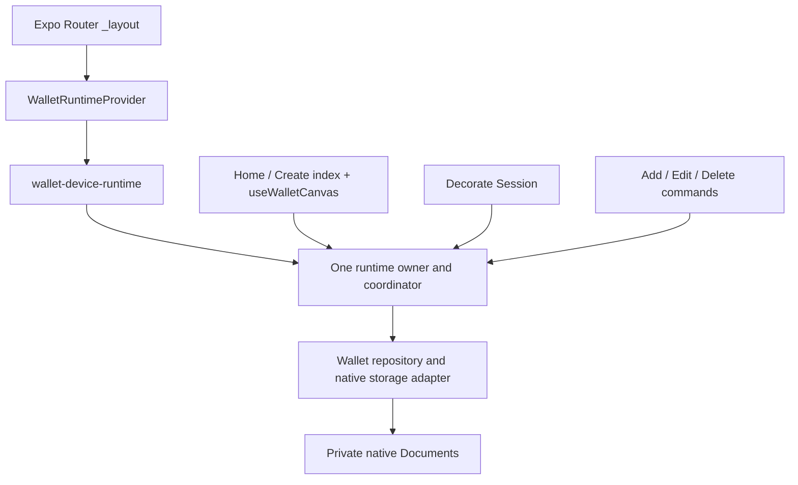

# bemem architecture and data contract

Current working-tree architecture reviewed 2026-11-23. HEAD `3ec5a45bd9765594f5901b8ab196ba2f8950bde4` predates substantial uncommitted changes. [RELEASE-BASELINE.md](RELEASE-BASELINE.md) is historical. This documentation phase introduces no runtime layer or schema.

## Boundaries

| Responsibility | Actual source |
| --- | --- |
| Fonts/routing/provider | `src/app/_layout.tsx`, `src/components/bemem/WalletRuntimeProvider.tsx` |
| Main Home/Create orchestration | `src/app/index.tsx`, `src/hooks/use-wallet-canvas.ts` |
| One runtime owner | `src/lib/wallet-device-runtime.ts`, `wallet-cutover-runtime.ts`, `wallet-runtime-owner.ts`, `wallet-coordinator.ts` |
| Snapshot IO | `src/lib/wallet-repository.ts`, `wallet-storage.ts`, `wallet-storage-adapters.ts`; legacy `canvas-storage.ts` |
| Create commands | `src/lib/wallet-feature-commands.ts`, `card-form-adapter.ts`, `membership-card-edit.ts` |
| Forms | `src/components/bemem/AddCardEditor.tsx`, `EditMembershipCardEditor.tsx`, shared `AddCardForm.tsx`/`AddCardSheet.tsx` |
| Canvas/pages | `WalletCanvas.tsx`, `src/lib/canvas-layout.ts`, `canvas-pages.ts`, `card-size-presets.ts`, `search-reflow.ts` |
| Decorate | `DecorateMode.tsx`, `src/lib/decorate-session.ts`, decoration catalog/pagination and bundled image registry |
| Folders | `src/types/group-folder.ts`, `src/lib/group-folder.ts`, `group-folder-visual.ts`, `GroupFolderCard.tsx`, `GroupFolderSheet.tsx` |
| Detail/codes/full view | `MembershipCardDetail.tsx`, `CardCodeView.tsx`, `FullScreenCardView.tsx`; `src/lib/card-code.ts`, `code128-display.ts` |
| Artwork | `src/lib/card-artwork-store.ts`, `card-artwork.ts`, `artwork-adjustment.ts`, `default-card-artwork*.ts`, `src/constants/default-card-artwork.ts`, `CardArtworkImage.tsx` |
| Share | `ShareCardSheet.tsx`, `CardShareSurface.tsx`, `src/lib/card-share-plan.ts`, `card-share-session.ts`, `card-share-native.ts` |
| History/receipts | `CardHistorySheet.tsx`, `ReceiptAttachments.tsx`, `ReceiptViewer.tsx`, `src/lib/card-history*.ts`, `receipt-picker.ts` |

Component filenames without a prefix are under `src/components/bemem/`; grouped lib filenames share the first listed directory. These are current paths, not proposed modules. Some source comments still describe early Phase2 milestones; follow actual call sites and this baseline rather than treating those historical comments as feature gates.

## Persisted model

`src/types/wallet-document.ts`: `{schemaVersion:2,dataset:'bemem-wallet',revision,savedAt,cards,canvas}`. Canvas has12 columns and a card-ID→integer `{col,row}` layout. Optional additive `decorations`, `pages` and `folders` extensions preserve legacy reads; validation is in `wallet-validation.ts`. Membership payload/number stay strings, including leading zeros, spaces and case. New size triples reference the existing nine preset definitions; old records resolve by legacy rules without rewriting files.

`canvas.folders` is `{version:1,items:GroupFolder[]}`. Each item has stable `id`, `name`, `orientation`, `position`, `memberCardIds`. Members remain normal card records with unchanged IDs/artwork/history; relationships do not copy or delete cards. Their old placement hints remain. `walletCanvasPresentation()` hides grouped members from the outer collision projection and presents one full6×4/4×6 Folder. Contents packing is separate presentation. Ungroup uses safe existing placement on the same page, rejecting insufficient space; a singleton dissolves safely.

`canvas.pages` is `{version:1,assignments,selectedCount?}`. Absent assignments mean page1. IDs retain their page; page projection is detached, not a whole-wallet replacement. `canvasAccess()` currently returns all five pages visible, readable and editable for functional testing. Existing selected-count metadata is retained; this does not fabricate Login or Premium entitlement. Page-scoped mutation rules still reject cross-page changes. Membership status is not a billing service. Page switches, draft/write admission and generation checks remain owner-controlled.

## Save and recovery contract

Saved and Draft are detached Wallet snapshots. Create operations update Draft through the owner; explicit Save is the persistent boundary. Discard restores the existing Saved/entry contract, not an arbitrary historical revision. Search Reflow is temporary presentation and never writes search positions. Decorate snapshots its entry draft, records accepted actions in in-memory Undo/Redo, and Cancel restores that entry (including pre-existing Create changes). A completed Folder drag updates only `folders.items[].position`; Tap in Decorate does not open management.

Repository Save validates Cards+Canvas as **one snapshot**, checks expected revision/pending inside its JS-process transaction gate, writes an exclusive pending file, reads/validates it, promotes to an immutable revision file and verifies committed readback. Never report success before the current commit/readback contract completes. Pending/conflict/corrupt/unsupported/commit-uncertain remain distinct; no silent fallback to old v1/revisions and no automatic uncertain retry. Owner/coordinator control source, revision, generation, Save admission and runtime activation. This JS-process lock is not a multi-process or power-loss atomicity guarantee.

Native `wallet-storage.ts` stores snapshots under `Documents/bemem-wallet-v2/`. Legacy v1, explicit pre-cutover backup, artwork and history/recovery stores remain separate. Existing `wallet-release.ts` actually lives in **src/constants**, not lib; it permits the existing explicit review/consent flow only. Handoff never invokes backup, migration, import or reset.

## Artwork and UI contracts

Bundled defaults live in `assets/card-faces/`; static requires and integrity metadata are registered in the existing default-artwork modules. Each new Add session chooses one matched pair once. Preview sources remain stable while immutable versioned files are retained in `Documents/bemem-card-artwork/`; only asset IDs/dimensions/checksum/crop references enter Wallet. Late preparation cannot rewrite form photos. Existing saved references are never rerandomized, including legacy Coral/Brown pairs. Photo, crop, default, Detail and Share retain the same underlying image contract.

Approved Lagoon Stack shells are static `assets/group-folders/` PNGs with ordered back→member cells→front lip→name layers. The presentation helper supplies responsive gutters without changing Grid dimensions. All270 decorative assets remain local and separate from functional icons.

Card Detail uses the existing QR/Code128 encoders and exact saved payload, with white backgrounds and quiet zones; demo cards do not receive fabricated codes. Share uses the existing dedicated export surface and native sharing, not a whole-screen capture. My Keeps and legacy History/receipts share the existing local history repository and recoverable card/history deletion policy; do not assume cross-store cleanup is one atomic wallet transaction.

Home is read-only for Wallet layout/card management; Home My Keeps/Add Keep can mutate their separate History store through its existing guarded capability. Create owns card/folder management; Decorate owns movement/sticker actions within its draft. DEV routes under `src/app/dev-*` are existing guarded diagnostics/previews and may include destructive test-sandbox tools; they are not ordinary startup, production wallet reset tools or permissions to manipulate real data.

## Regression-sensitive limits

Preserve 12 columns, 240-row production validation, all nine footprints, 0.1-block inset, 14dp card corners, five-page navigation, current header/footer geometry, 350ms hold and removed Home swipe. NavigationHeader currently centers the brand independently of the side controls, uses a 48dp normal region and has an enlarged-text fallback; old eight-slot geometry is historical. Do not swap source/owner after commit without coordinated activation. Do not change immutable artwork bytes/IDs, member ordering, name/number/payload strings, writer scope, backup rules or receipt cleanup merely to restyle UI.

Editable masters/test fixtures remain at their existing preview/trial paths because tests/generators reference them. [DEV-HANDOFF.md](DEV-HANDOFF.md) gives exact commands and artwork provenance; [CLEANUP-REPORT.md](CLEANUP-REPORT.md) records the verified quarantine.

## Current Keeps and native-media data flow

`MembershipCardDetail.tsx` exposes Home My Keeps / Add Keep. Arrange management remains separate. `KeepsSheet.tsx` creates a Card-scoped `createHistoryCommands` capability. Record loading (`reload`) and recovery/notification inspection (`inspectRecovery`) start independently. Slow native inspection must not prevent read-only list access. `keeps-lifecycle.ts` coordinates process-local inspection sharing, mutation admission and picker leases; its observer deadline never cancels a native promise.

`KeepEditor.tsx` prepares All-in-One, Reminder, Gallery, Note or Camera drafts. The internal `full` identifier remains unchanged by the All-in-One label. `keeps.ts` validates content and constructs a reminder instant in the device's local timezone. `ReminderScheduleFields.tsx` / `ReminderTimePicker.tsx` provide the existing calendar and time-wheel UI.

| Stage | Admission and state | Persistent effect |
| --- | --- | --- |
| Picker | Current Card/Owner/editor session, safe operation state, one native picker lease; Camera permission | SDK may create temporary cache media; no bemem Documents retain |
| Staging | Temporary URI bound to originating editor and Owner; not a saved Receipt | In-memory only; text stays editable while retention readiness is pending |
| Retain | Current generation/revision/capability and existing History/Recovery readiness; rechecked across awaits | `keepMediaFiles` exclusively reserves a new receipt file, validates signature/decode/size/checksum and tracks ownership |
| Save | Original History capability, Owner/revision, pending/uncertain/mutation guards | History snapshot commit/readback; Reminder scheduling then status persistence; never automatic draft Save |
| Cancel/Unmount | Only proven-owned, unreferenced, never-uncertain files may be released | Narrow exact-path cleanup; no original-photo or directory sweep |

`card-history-native.ts` supplies native receipt ports. `receipt-picker.ts` retains the legacy picker path and provides the selection-only `selectKeepReceipt` path for Keeps. `card-artwork-store.ts` remains the existing Card artwork pipeline. `keep-media-files.ts` tracks unsaved receipt tickets in JS memory, not a durable journal. Missing SDK cache files are errors, not saved images. Unknown cleanup preserves evidence and prevents write retry. Recovered Android pending picker results are not automatically adopted without verified origin.

## Reminder and recovery ownership

`keep-notifications-native.ts` configures notification presentation, Android channel, permissions and DATE scheduling. `keep-notifications.ts` uses `bemem-keep-<recordId>` identifiers and returns scheduled/denied/failed metadata. `keep-recovery.ts` handles durable Complete/Delete intents, verified cancellation and readback. `history-recovery-files-native.ts` stores those intents separately from History snapshots. Reminder completion/deletion does not blindly retry uncertain writes or recreate missing data.

The native pending queue proves only current pending membership. Absence does not prove delivery, cancellation or that scheduling never happened. `reminderNotificationLabel()` distinguishes checking/unknown/verified evidence and overdue presentation; it does not persist a fabricated delivered state.

## Persistent ownership map

| Native location | Owner |
| --- | --- |
| Documents/bemem-wallet-v2 | Wallet Repository: Cards + Canvas snapshot |
| Documents/bemem-phase1-canvas (or existing empty fixture variant) | Legacy v1 canvas adapter; preserved during cutover |
| Documents/bemem-pre-cutover-backup | Explicit approved cutover backup; not created by this documentation task |
| Documents/bemem-card-artwork | Existing artwork store; Wallet contains immutable references and crop metadata |
| Documents/bemem-card-history | History Repository shared by Keeps and legacy History |
| Documents/bemem-receipts | Receipt images referenced by History; unsaved Keep ownership tracked by keepMediaFiles |
| Documents/bemem-history-deletions | Card/history and notification recovery intents/pending evidence |
| Documents/bemem-profile | Local profile name/avatar persistence; not authentication |
| Cache/bemem-share-exports | Dedicated Share preview/export surfaces, not original media storage |
| SDK image-picker cache | Temporary selected/captured files; not a durable bemem draft |

These separate stores do not form one atomic filesystem transaction. See [SAFETY-INVARIANTS.md](SAFETY-INVARIANTS.md) and [KNOWN-ISSUES.md](KNOWN-ISSUES.md). Local storage encryption, OS backup policy and native-crash behavior are not certified by Hermes bundling or JS mocks.

## Completed presentation motion (developer review, 2026-11-23)

`src/app/index.tsx` coordinates guarded navigation after inline Card Detail dismissal; generation, saving, mode and confirmed page are rechecked. `CardPreview.tsx` owns M2 identity/epoch and native-driver transform/backdrop, while MembershipCardDetail owns its controls and busy guards. `KeepsSheet.tsx` composes separate `keeps-motion.tsx` (M3-A), `keeps-navigation-motion.tsx` (M3-C) and `keeps-editor-motion.tsx` (M3-B) sessions. AddCardSheet/KeepEditor expose opt-in presentation slots without changing ordinary Add/Edit motion. Outer and internal transitions do not duplicate editors or replay on data refresh. `FooterMotion.tsx`/`ContextualFooter.tsx` own M4-A mount-only opacity and the pre-existing confirmed-page pill/tail. Motion never substitutes for Owner, media, Recovery or transaction admission. M4-B/C remain unchanged; no geometry redesign is part of handoff.
